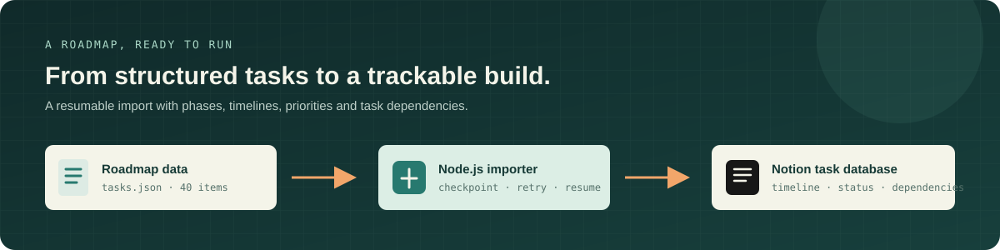

<div align="center">

# Notion Roadmap Importer

### Turn a structured microservices roadmap into a working Notion project board.

Import a dependency-aware e-commerce microservices roadmap into Notion with a small, resumable Node.js CLI.

<p>
  
</p>

<p>
  
  
  
  
</p>

</div>

## Overview

This project takes the structured plan in [`tasks.json`](tasks.json) and creates a Notion database for tracking an e-commerce microservices build. The roadmap covers planning, containerization, core services, integration, observability, CI/CD, and deployment.

The importer creates database properties for phase, skills, estimate, priority, status, timeline, owner, and task dependencies. It saves progress locally, so an interrupted import can be continued without recreating pages.

> **Current scope:** This repository is a roadmap importer and task dataset. The microservices listed in the roadmap are planned work, not implemented services. Despite the `mcp.js` filename, this project is currently a command-line importer, not an MCP server.

## At A Glance

| | |
| --- | --- |
| Roadmap | 40 tasks across 9 phases |
| Runtime | Node.js 18+ |
| Integrations | Notion API |
| Entry point | `mcp.js` |
| Input data | `tasks.json` |
| Progress state | `.notion-state.json` (local, ignored by Git) |

## Roadmap

1. **Planning** — scope, service boundaries, data stores, API contracts
2. **Docker foundation** — container templates, Compose, shared libraries
3. **Core services** — users, product catalog, cart, orders, payments, notifications
4. **Integration** — API gateway, service communication, asynchronous events
5. **Service discovery** — Consul
6. **Observability** — health checks, centralized logs, metrics and dashboards
7. **CI/CD** — automated builds, image publishing, deployment pipelines
8. **Deployment** — orchestration, scaling, load testing
9. **Docs and wrap-up** — project and API documentation

The roadmap is a planning dataset, not a claim that these components are already production-ready.

## Getting Started

### Prerequisites

- Node.js 18 or later and npm
- A Notion integration with permission to create and edit content
- A Notion parent page shared with that integration

### 1. Install dependencies

```bash
npm install
```

### 2. Configure Notion access

Copy the example environment file and fill in your own integration credentials:

```bash
cp .env.example .env
```

On Windows PowerShell, use `Copy-Item .env.example .env` instead. Set:

| Variable | Description |
| --- | --- |
| `NOTION_TOKEN` | Internal integration token from your Notion integration settings |
| `NOTION_PAGE_ID` | ID of the parent Notion page where the database should be created |

Before running the importer, open the parent page in Notion and add your integration under **Connections**. Keep `.env` private; it is excluded from version control.

### 3. Run a small test import

```bash
node mcp.js --limit=3
```

This creates the database if needed and imports the first three tasks. The import is incremental: rerunning the command skips tasks already recorded in `.notion-state.json`.

### 4. Import the complete roadmap

```bash
node mcp.js
```

The importer creates the remaining task pages, then adds and fills the self-referencing **Depends on** relation after all roadmap tasks exist. Notion rate-limit responses are retried automatically.

When it finishes, open the database in Notion and create a **Timeline** view using the `Timeline` property.

## Import Behavior

- `--limit=N` imports up to the first `N` tasks, which is useful for a small trial.
- A full run resumes using the local `.notion-state.json` checkpoint.
- The importer does not delete existing Notion pages or databases.
- Keep the checkpoint to resume the same import. Removing it causes the script to create a new database on its next run.
- The script waits between API calls and retries rate-limit (`429`) errors.

## Task Data

Each item in `tasks.json` uses this shape:

```json
{
  "task": "Define scope and MVP features per service",
  "phase": "0 - Planning",
  "skills": ["Planning"],
  "days": 1,
  "dependsOn": [],
  "priority": "High",
  "start": "2026-10-12",
  "deadline": "2026-10-12",
  "owner": "Me"
}
```

Dependency values must match another task's `task` value exactly. Dates use `YYYY-MM-DD`; priorities are `High`, `Medium`, or `Low`.

## Troubleshooting

| Problem | What to check |
| --- | --- |
| `Missing NOTION_TOKEN or NOTION_PAGE_ID` | Confirm `.env` exists in the project root and both values are set. |
| `object_not_found` | Share the parent page with the integration using Notion's **Connections** menu, and verify the page ID. |
| Import stopped partway through | Run the same command again; the checkpoint records completed pages. |
| Dependency column is not filled yet | Run without `--limit` to import the complete roadmap and finish relation linking. |

## Security

Never commit `.env` or `.notion-state.json`. Use `.env.example` as a template, and store real credentials only in your local environment or a secret manager. If an integration token is ever committed or shared, revoke it in Notion and generate a replacement.

## License

No license has been added yet. Add a `LICENSE` file before presenting this repository as open source, so others know what permissions apply.